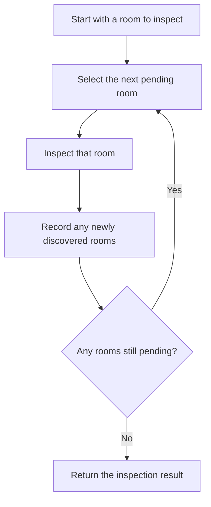
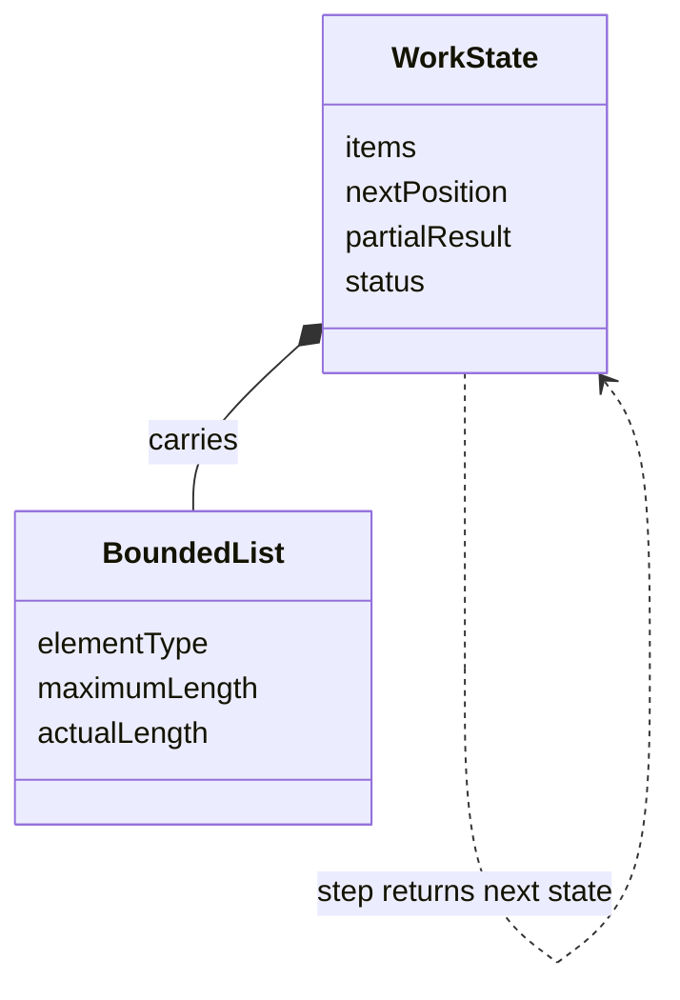
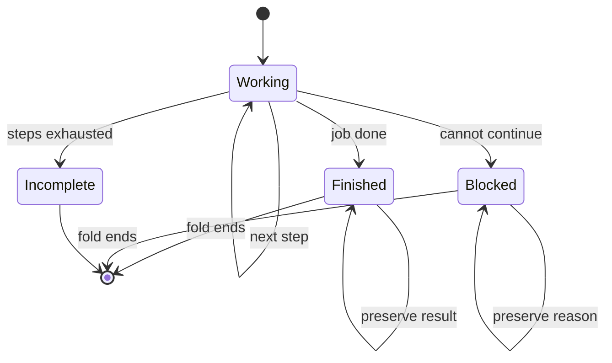
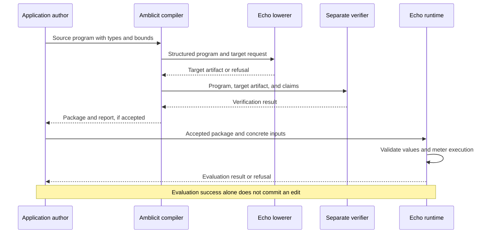

<!-- SPDX-License-Identifier: Apache-2.0 OR LicenseRef-MIND-UCAL-1.0 -->
<!-- © James Ross Ω FLYING•ROBOTS <https://github.com/flyingrobots> -->

# Bounded Worklists

A **worklist** is a program's list of things still to do. A **bounded worklist**
puts explicit limits around that work: how much information one list can hold,
how many steps a run may take, and how much resource those steps may consume.

This lets a program discover more work while it runs without making an
open-ended promise to finish everything it might discover.

You do not need to know Echo, Amblicit, or programming language theory to read
this page. Start with the list and its limits. The later sections connect that
idea to real Amblicit programs, Echo's Rust interpreter, and the text-editor
problem that motivated this work.

**Related:** [Application contract hosting](../architecture/application-contract-hosting.md)
owns the exact provider and runtime rules. This page explains those rules and
their motivation; it does not introduce another execution contract.

## 1. A list that can discover more work

Imagine inspecting a house. Your first task is “inspect the hall.” In the hall,
you discover doors to a kitchen and a study, so you add those rooms to your
list. Inspecting the study might reveal another room.

The list records what you have discovered. A marker records which item to
inspect next. This is useful because you did not need to know every room before
starting.



This diagram describes the general idea. We still need limits: the house might
be enormous, or a faulty program might keep adding the same room. A program
must define its order and, where needed, how it recognizes repeated work.

In computing, an item might instead mean “inspect this tree node,” “check this
record,” or “revisit this calculation because an input changed.” The worklist
contains data describing that job. It is not a collection of independently
running workers.

## 2. Three limits that answer different questions

Suppose the inspection allows a list of at most eight entries and at most five
inspection steps. Those numbers answer different questions:

| Limit           | Question it answers                                       | What it does not establish                       |
| --------------- | --------------------------------------------------------- | ------------------------------------------------ |
| List capacity   | How many entries may this list value contain?             | How many times an entry can be revisited         |
| Step bound      | How many times may this run call its step function?       | Whether all the discovered work will be finished |
| Resource budget | How much charged work and storage may evaluation consume? | An exact duration in seconds on every computer   |

An item needs a bounded size too. “At most eight entries” would be a poor
memory limit if each entry could contain an unlimited amount of text.


The drawing shows one possible **cursor** design: the marker is an integer
position, and earlier entries remain in the list. There are five stored entries
but only three pending entries. The three empty slots are unused capacity, not
three more jobs.

Because this design keeps the processed prefix, capacity limits the total
entries retained in the current list, not just its pending suffix. It does not
automatically recycle old slots. Other representations need their own rules.

Likewise, a capacity of eight does not mean that the whole program allocates
only eight objects. Creating results, copying elements, and validating nested
values also have costs.

## 3. Carrying the list from one step to the next

A single step needs more than a list. It may also need the next position, a
result being assembled, and a status such as “working” or “finished.” Together,
these values form the computation's **state**: the information needed to
continue this one computation.

The boxes below describe an example's data. They are not built-in Echo classes.



A **type** is a rule describing which values are allowed. A bounded list type
specifies both the element type and the maximum length. A state type can group
several such values in a **record**, a value with named fields.

A **fold** repeatedly passes state through a step function:

```text
initial state → step → next state → step → next state → final state
```

In Amblicit, the language used to author these computations, the supported form
is `fold(initial, step, bound)`. The step is a named function with one state
parameter and the same declared state type as its result. It receives a value
and returns the next value. The author does not need a mutable local variable
or an unrestricted recursive function to carry progress.

The fold calls the step exactly `bound` times on a successful run. A runtime
failure can stop evaluation sooner. A bound of zero returns the checked initial
state without calling the step; it does not excuse malformed helper code from
validation.

### Stopping the work is different from stopping the fold

If the job finishes after three steps of a five-step fold, the step function
can return the finished state unchanged on the remaining two calls. Those
calls still have evaluation and validation costs.

The application must also distinguish “finished” from “ran out of room” and
“used all steps while work remained.” One possible authored status model is:



These are explanatory application statuses, not automatic statuses produced by
the list library. The author supplies the completion test and the outcome
policy. A host resource refusal is a separate evaluation failure.

**A bounded attempt is not necessarily a completed job.** Returning a partial
result, refusing the request, or arranging another explicitly authorized run
are different application contracts. A fold does not silently choose one.

## 4. The actual Amblicit building blocks

The current list surface provides four operations:

| Amblicit operation        | Meaning                                                | Required boundary                                                  |
| ------------------------- | ------------------------------------------------------ | ------------------------------------------------------------------ |
| `listLen(xs)`             | Obtain the current number of entries                   | The value must be a valid list                                     |
| `listAt(xs, i)`           | Obtain the entry at position `i`                       | Establish `i < listLen(xs)` for these operands                     |
| `listAppend(xs, item)`    | Produce a list with one more entry                     | Establish room below the declared maximum                          |
| `listConcat(left, right)` | Produce the left entries followed by the right entries | Compatible element identities and a checked sum of declared maxima |

Positions start at zero. A three-entry list has positions zero, one, and two;
position three is already outside it. That is why access needs a strict `<`
comparison. `i <= listLen(xs)` is too weak.

Such a preceding condition is called a **guard**. It must establish the fact
for the same list and index used by the access. The checker recognizes
supported guard forms; it is not a general solver for every mathematically
equivalent expression.

Append preserves the list's declared maximum. Concatenation derives its maximum
from the two declared maxima: a maximum-two list joined to a maximum-one list
has maximum three, even when both happen to be empty. Limits are part of the
type, not a guess from the current contents.

The current surface does not supply a general queue library or automatic
deduplication. A cursor, completion flag, or path stack belongs to the authored
algorithm and must fit the supported operations.

### A real function, one line at a time

Here is actual Amblicit from the
[maintained public worklist specimen](../../scripts/consumer-witnesses/list-worklist-sources.ts).
The TypeScript file contains the Amblicit programs submitted to the compiler.
This function is an excerpt, not a standalone application package:

```edict
fn step(xs: List<U8,max=3>) -> List<U8,max=3> {
  let value = if 0u64 < listLen(xs) then listAt(xs,0u64) else 7u8;
  return if listLen(xs) < 3u64 then listAppend(xs,value) else xs;
}
```

Read `List<U8,max=3>` as “a list of at most three small unsigned integers.”
`U8` allows values from zero through 255. `U64` is a larger unsigned integer
type used here for lengths and positions; the suffixes on `0u64` and `7u8`
select those types.

The first line inside the function chooses a value. If the list has an entry
at position zero, it reads that entry. Otherwise, it chooses seven. The test
comes before the access and names the same list and position.

The next line appends that value only when the list has fewer than three
entries. Once the list is full, it returns the existing value.

The public specimen also contains these actual statements:

```edict
let joined = listConcat(input.left,input.right);
let items = fold(joined,step,5u64);
let selected = if input.index < listLen(items) then listAt(items,input.index) else 0u8;
```

Here `input.left` has maximum two and `input.right` has maximum one. If both
are empty, the five calls produce:

| Point           | List value  | What happened                           |
| --------------- | ----------- | --------------------------------------- |
| Before the fold | `[]`        | The two empty inputs were joined        |
| After call 1    | `[7]`       | The empty-list fallback supplied seven  |
| After call 2    | `[7, 7]`    | The first entry was read and appended   |
| After call 3    | `[7, 7, 7]` | The list reached capacity               |
| After call 4    | `[7, 7, 7]` | The full-list branch preserved it       |
| After call 5    | `[7, 7, 7]` | The full-list branch preserved it again |

This small specimen proves useful mechanics: building a bounded value, carrying
it through repeated steps, and selecting an entry safely. It is deliberately
smaller than a complete tree traversal or editor operation.

## 5. Why Echo cares about these limits

**Echo is a runtime:** software that evaluates authored computations and
enforces the rules around them. Its durable record is an accepted history of
changes. An editor buffer or graph view is a reading of that history.

**Amblicit is the authoring language and compiler.** The compiler turns the
program into a structured description that Echo can check and execute. Echo's
lowerer translates that description for the target. A separate verifier checks
the relevant program, type, capability, and resource claims independently of
the lowerer's judgment.

A **capability** names a supported part of that contract. These list operations
use `core.list/v1`; the bounded fold uses `core.fold/v1`. A consumer that does
not support the required capability must refuse it explicitly.



The limits make the promise inspectable before running the program. At a
conceptual level, the cost includes the initial state, the declared number of
complete steps, and the final result. “Complete step” includes argument
validation, helper calls, copies, and the step's own computation. Arithmetic
used to calculate bounds must itself be checked for overflow.

At runtime, Echo also checks the actual values and charges the work performed.
This matters because a declaration cannot make an invalid value valid, and an
allocator may still fail. Bounds describe charged resource obligations; they
do not guarantee a particular wall-clock latency or eliminate host allocation.

### The loop in Echo's actual Rust interpreter

After checking that the helper has the required signature, Echo executes this
code in [the expression evaluator](../../crates/warp-core/src/edict_pure/evaluate.rs):

```rust
let mut value = expression(initial, locals, helpers, meter, depth + 1)?;
validate(&value, state, meter, depth + 1)?;
for _ in 0..*bound {
    meter.step(depth + 1)?;
    validate(&value, &helper.params[0].ty, meter, depth + 1)?;
    let frame = BTreeMap::from([(helper.params[0].id.as_str(), value)]);
    value = helper_body(helper, frame, helpers, meter, depth + 1)?;
}
Ok(value)
```

`value` holds the current state. `0..*bound` performs the declared number of
iterations. `meter.step` charges a step. `validate` checks a value against its
type. The `frame` gives the helper its input for this call. In Rust, `?` returns
an error immediately if the preceding operation failed.

The loop reuses one iteration structure instead of nesting one native call
inside the previous iteration. Expression nesting and helper-call depth still
have their own limits. Rust's local `mut` belongs to the interpreter's
implementation; the authored Amblicit function still receives and returns
values.

### The capacity check is also real

After validating the list and the new element, Echo's
[list evaluator](../../crates/warp-core/src/edict_pure/list_operations/evaluate.rs)
contains this append path:

```rust
if u64::try_from(values.len()).map_err(|_| Error::InvalidArtifact)? >= *max {
    return Err(Error::InvalidArtifact);
}
// Moving values avoids an extra host copy, but does not remove the
// portable charge for a complete immutable result.
charge_result(values.iter().chain(std::iter::once(&entry)), meter)?;
values
    .try_reserve_exact(1)
    .map_err(|_| Error::HostAllocationFailed)?;
values.push(entry);
Ok(Value::Array(values))
```

The runtime refuses an already-full list. It charges the complete result before
requesting space for another element. Then it adds the element and returns the
array value. Moving existing Rust values is an implementation optimization;
it does not erase the operation's portable resource charge.

## 6. Reading stored data and changing the world

So far, the examples compute with values already supplied as input. That is
**pure computation**: the helper has no independent authority to read storage
or change application data.

A program that reads stored data also needs a **basis**, the selected starting
history against which the reading is made, and an **aperture**, the bounded
portion it is permitted to inspect. A name inside a list is just data. Resolving
that name against storage needs the permitted read operation and its evidence.

The current public worklist witness exercises both pure computation and the
ordered stored-read route. In the read specimens, the operation obtains stored
bytes, checks them, and supplies them to a pure fold. That does not make the
step function a storage-reading callback.

An **effect** is a proposed application change. Evaluating a worklist, proposing
effects, and accepting those effects into history are distinct boundaries.
Echo's trusted runtime controls the **tick**, the boundary at which it decides
the relevant changes and outcomes. The list feature alone does not establish
rope mutation, tick settlement, or durable recovery.

Within one fold, each step depends on the preceding state, so the sequence is
ordered. Deciding which separate operations may overlap belongs to Echo's
scheduler and admission rules. A small worklist does not by itself prove that
two operations touch independent data or may safely run concurrently.

## 7. Where this came from: walking a text editor's tree

Worklists are a general programming technique. For example, Clang's
[data-flow analysis introduction](https://clang.llvm.org/docs/DataFlowAnalysisIntro.html#formalization)
describes a worklist queue that revisits parts of a program when their inputs
change. The order and completion conditions depend on the algorithm.

The immediate motivation here came from **Jim**, a text editor being built on
these foundations. Its planned authored text operation works on a **rope**:
a tree whose leaves hold pieces of text. Internal nodes summarize their
children so an edit can find the relevant piece without treating the whole
document as one flat string.


To replace a range, an algorithm may need to descend toward the relevant text,
remember the ancestors it visited, and rebuild the changed route on the way
back. That remembered path is a natural bounded list. A traversal also needs
state such as its current node, remaining offset, and completion status.

The project chose to investigate iterative descent and rebuild with explicit
state instead of making recursive types a prerequisite. The design trail is
visible in three connected requirements:

1. [State-carrying iteration](https://github.com/flyingrobots/amblicit/issues/268)
   supplies an initial state, a named step, a bound, and a final state.
2. [Bounded list operations](https://github.com/flyingrobots/amblicit/issues/289)
   let that state measure, select from, and build a path or worklist.
3. [Echo's consumer contract](https://github.com/flyingrobots/echo/issues/946)
   requires independent checking, published provider artifacts, and actual
   execution of the compiler's output.

The diagram is an explanation of that motivation, not evidence that a complete
rope editor follows from the four list operations. Stored-node resolution,
content identity, effects, and the full edit algorithm have additional
contracts and acceptance obligations.

The broader
[collections and optics design](https://github.com/flyingrobots/amblicit/issues/288)
also draws on _Edict collections v2: places, payloads and witnessed optics_
(Claude, 22 October 2026). It explores ownership, membership, observations, and
proposed changes. An **optic**, in that design, describes what to focus on and
what observations or edits are permitted there. An observed value and a
proposed change remain separate artifacts.

That is a wider problem than a temporary list used during computation. A
bounded list does not itself create a stored collection, assign ownership,
grant read authority, or implement the collections proposal. The roadmap
preserves those distinctions.

## 8. When to use the pattern

These are uses of the general pattern, not a claim that Echo already ships
each complete application:

| Situation                 | What the list carries              | What must be bounded or decided                           |
| ------------------------- | ---------------------------------- | --------------------------------------------------------- |
| Tree descent and rebuild  | Ancestors or deferred branches     | Depth, element size, reads, and rebuild work              |
| A finite validation batch | Records or checks still to inspect | Batch size, each check's cost, and failure policy         |
| Dependency propagation    | Items needing reconsideration      | Revisits, duplicate handling, and a completion criterion  |
| A bounded search          | Candidate positions or nodes       | Frontier growth, visits, and an honest incomplete outcome |

The pattern is useful when you can explain both the work's shape and what
happens at its limits. Explicit state also makes progress easier to inspect:
the current position and partial result are ordinary values with declared
shapes.

It is a poor fit for a promise to process an unlimited stream in one operation.
Splitting such work into bounded runs requires a separate continuation
protocol: what is retained, which basis the next run uses, and how the next
attempt is authorized. Merely saving a list does not settle those questions.

Before choosing the bounds, ask: How large can an item be? How many items can
the algorithm retain? How many steps can it take? What does it report if work
remains? Those answers are the useful contract a bounded worklist makes
explicit.

## Read further

- [Application contract hosting](../architecture/application-contract-hosting.md):
  the authoritative fold, list, provider, read, and resource boundaries.
- [Authored worklist programs](../../scripts/consumer-witnesses/list-worklist-sources.ts):
  the complete specimen definitions, including expected refusals.
- [Public runtime witness](../../xtask/examples/source_functions_public_runtime/worklists.rs):
  checks of actual results, input types, and resource limits.

The SVGs have transparent canvases and use Reader's `--ink`, `--muted`,
`--accent`, and `--line` roles when inlined. Image embeds use light/dark
fallbacks because CSS custom properties do not cross the image boundary.
Mermaid diagrams use the reader application's renderer and theme.
